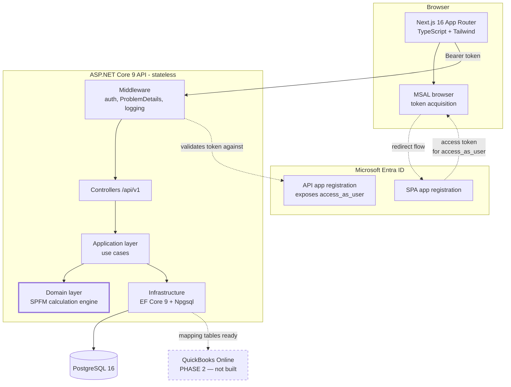
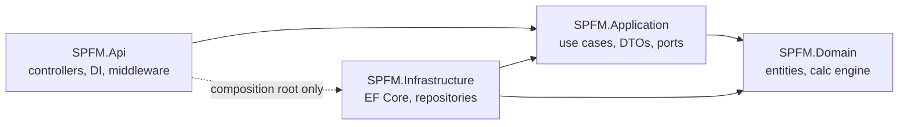
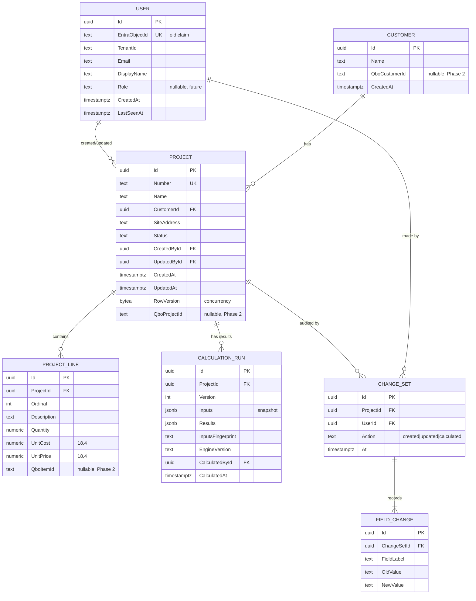
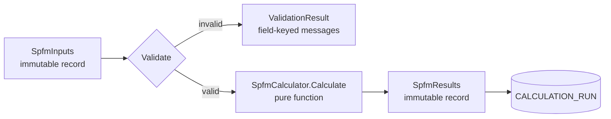

# SPFM — System Design

**Shield Project Financial Management**
Internal project financial management application for Shield Security Doors.

| | |
|---|---|
| Document status | Draft for review |
| Date | 15 October 2026 |
| Target | Alpha (Growth Plan scope) |
| Source of requirements | `SPFM_Requirements.pdf` (48 sections), SPFM Developer Handoff |

---

## 1. Purpose

A single Shield user signs in with their Microsoft work account, creates or opens a
project, enters SPFM financial data, runs the SPFM calculations, saves, reopens later,
edits, recalculates, and sees a record of what changed — on deployed internal hosting.

That sentence is the Alpha acceptance condition (requirements §46–47). Every decision in
this document is justified by whether it serves that loop or prepares for the QuickBooks
phase that follows it.

### 1.1 Explicit non-goals for this phase

Carried directly from requirements §42. These must not absorb budget:

- QuickBooks automatic import (Phase 2, quoted separately)
- User roles and permission management
- Data exports (Excel/CSV/PDF)
- Advanced error monitoring
- Accounting functionality beyond the agreed SPFM calculations
- Payments, customer-facing site, marketing pages, mobile app

The architecture must not *prevent* these. It must not *contain* them.

---

## 2. Scope note on scale

The requirements state plainly (§4): *"I am the only user."* Roles are explicitly out of
scope (§42).

This design nonetheless targets **thousands of projects and thousands of users**, as
requested. That is reconciled as follows:

- **Data layer and API are built for scale now.** Keyset pagination, correct indexing,
  no N+1 queries, stateless services, optimistic concurrency. These cost nothing extra
  to do correctly on day one and are expensive to retrofit.
- **Multi-user *mechanics* are built now.** Every row carries `CreatedBy`/`UpdatedBy`,
  every write is attributed to an authenticated Entra identity, and concurrent edits are
  detected rather than silently lost.
- **Role and permission *features* are not built now.** No admin UI, no permission
  matrix, no approval workflows. A nullable `Role` column and an authorization policy
  seam exist so these can be added later without a migration of consequence.

A candid engineering note: for PostgreSQL, "thousands of projects and thousands of users"
is a small workload — well under a single modest database instance's capacity. The risk
at this size is never raw throughput; it is the handful of design mistakes that turn a
small dataset into a slow application. Section 11 lists exactly those mistakes and how
this design avoids each. We are not building for scale we do not have; we are declining
to build in the defects that would make a small system feel slow.

---

## 3. Architecture overview



The calculation engine (bold) sits in the Domain layer with no dependency on the
database, HTTP, or the UI. Requirements §11 require exactly this separation so
calculations can be tested independently.

---

## 4. Technology choices

| Concern | Choice | Why |
|---|---|---|
| Backend | ASP.NET Core 9 Web API | Client's existing stack; his auth already works on it |
| Language | C# 13 | — |
| Database | PostgreSQL 16 | Client's `docker-compose.yml` already specifies it; `numeric` type is exact for money; strong indexing (GIN/trigram) for search |
| ORM | EF Core 9 + Npgsql | Migrations are a deliverable (§30); LINQ keeps queries reviewable |
| Auth | Microsoft Entra ID, JWT bearer | Already registered against Shield's tenant |
| Frontend | Next.js 16 (App Router), TypeScript | Client's existing version |
| Styling | Tailwind CSS v4 | Already in his frontend |
| Frontend auth | `@azure/msal-browser` | Redirect flow, no secrets in the browser |
| Backend tests | xUnit + Testcontainers | Real Postgres in integration tests, not a fake |
| Frontend tests | Vitest + Playwright | Unit tests for logic, E2E for the acceptance loop |
| Hosting | Azure (App Service or Container Apps) + Azure Database for PostgreSQL | §36; stateless API scales out horizontally |

### 4.1 Why PostgreSQL and not SQL Server

The client's own `docker-compose.yml` already provisions `postgres:16-alpine`. Azure
Database for PostgreSQL Flexible Server is a first-class Azure service. Changing to SQL
Server would contradict his existing setup for no benefit. If Shield's IT mandates SQL
Server, the EF Core provider is a one-line change plus a migration regeneration — the
domain and application layers are untouched.

---

## 5. Layering

The client's repository contains `Domain`, `Core`, `Application` and `Infrastructure`,
all empty, with a dependency graph that does not match any standard. We collapse this
into four projects with one-directional dependencies.



| Project | Contains | Depends on | Must never reference |
|---|---|---|---|
| `SPFM.Domain` | Entities, value objects, **SPFM calculation engine**, domain rules | nothing | EF Core, ASP.NET, HTTP |
| `SPFM.Application` | Use cases, DTOs, validation, repository *interfaces* | Domain | EF Core, ASP.NET |
| `SPFM.Infrastructure` | `SpfmDbContext`, repository implementations, migrations | Application, Domain | ASP.NET |
| `SPFM.Api` | Controllers, middleware, DI wiring, auth config | Application (+ Infrastructure at composition root only) | — |

`SPFM.Core` is deleted — it duplicates `Domain` with no distinct responsibility.

**Rule that matters most:** `SPFM.Domain` has zero NuGet dependencies beyond the base
class library. If the calculation engine can be unit-tested with no database, no
container and no HTTP context, the separation is real. If it cannot, it has been
violated.

---

## 6. Data model



### 6.1 Design decisions worth defending

**Calculation runs are append-only, never overwritten.** Each `Calculate` writes a new
`CALCULATION_RUN` with an incrementing `Version`, a snapshot of the inputs, and the
`EngineVersion` that produced it. This gives three things at no meaningful cost: a true
audit trail for financial figures, the ability to answer *"what did this project say in
March?"*, and the ability to detect that a stored result predates a formula change.
Overwriting a single results row would make all three impossible.

**`InputsFingerprint`** is a hash of the inputs the results were computed from. If the
current inputs hash differently, the UI shows *"Needs recalculating"* rather than
presenting stale figures as current. Requirements §16 require edit → recalculate to be
explicit.

**Change history is a `CHANGE_SET` with child `FIELD_CHANGE` rows**, not one row per
field. One user action produces one changeset, so the UI can show *"Updesh changed 3
fields at 14:32"* and expand it, rather than three disconnected rows. Requirements §17
asks for user / field / old value / new value / timestamp — all present.

**`Customer` is a separate table from day one.** QuickBooks Online models a project as a
sub-customer of a customer (§19). Embedding a customer name as text on the project would
force a painful migration in Phase 2. One extra table now avoids it.

**`RowVersion` on `Project`** gives optimistic concurrency. With more than one user,
two people editing the same project must not silently overwrite each other —
requirements §29 lists "avoid accidental data loss" as a data-integrity requirement.

### 6.2 The SPFM fields themselves — open

`PROJECT_LINE` and the scalar inputs above are a **reasonable placeholder, not the real
field list.** The real SPFM fields, their types, dependencies and selection rules come
from the client's handoff document (§12: *"The exact formulas should come from the
client's handoff document and provided examples rather than being invented during
development"*).

Until those arrive, scalar SPFM inputs are stored in a `jsonb` column on `PROJECT`
alongside the typed columns. When the field list is confirmed, frequently-queried fields
are promoted to typed columns via migration. This lets structural work proceed now
without inventing a schema that must then be unpicked. See §15.

---

## 7. Money and numeric precision

Requirements §29 is explicit: *"Money should not simply be handled as arbitrary
JavaScript floating-point numbers throughout the system."*

| Layer | Representation |
|---|---|
| PostgreSQL | `numeric(18,4)` — exact decimal, no binary floating point |
| C# | `decimal` — never `double` or `float` |
| JSON over the wire | String-encoded decimal, e.g. `"12345.6700"` |
| TypeScript | Parsed to a `Money` wrapper for display; never arithmetic in the browser |

**All arithmetic happens server-side in C# `decimal`.** The browser formats and displays;
it does not compute the figures of record. The existing TypeScript engine becomes, at
most, an optimistic preview — and if it ever disagrees with the server, the server wins.

**Rounding** is applied once, at defined points, using `MidpointRounding.AwayFromZero`
(standard commercial rounding) to 2 decimal places for currency outputs. Intermediate
values retain 4 decimal places to avoid compounding rounding error. The exact rounding
rules are a confirmed open question (§15) — requirements §12 lists "rounding rules" and
"numeric precision" as things that must come from the client's specification.

---

## 8. SPFM calculation engine



**Contract:** `SpfmResults Calculate(SpfmInputs inputs)` — a pure, deterministic,
side-effect-free function. Same inputs always produce the same outputs. No clock, no
randomness, no database, no I/O.

That property is what makes §13 (automated calculation tests) and §14 (validation against
real Shield projects) possible at all.

**Versioning.** The engine carries an `EngineVersion` constant, recorded on every
calculation run. When a formula is corrected, the version increments, and historical runs
remain attributable to the formula that produced them.

**Current state: placeholder.** The engine ported from our existing frontend implements
standard job-costing arithmetic as a stand-in. It is clearly marked as such and is **not
suitable for delivery**. It exists so the surrounding system can be built and tested; it
must be replaced with Samuel's real rules before the Alpha is accepted. This is the single
largest open risk in the project.

---

## 9. API design

Base path `/api/v1`. All endpoints require authentication except health.

| Method | Path | Purpose |
|---|---|---|
| `GET` | `/health` | Liveness — anonymous |
| `GET` | `/health/ready` | Readiness incl. database — anonymous |
| `GET` | `/api/v1/users/me` | Current user profile |
| `GET` | `/api/v1/projects` | List/search — `?q=&status=&cursor=&limit=` |
| `POST` | `/api/v1/projects` | Create |
| `GET` | `/api/v1/projects/{id}` | Full project with latest results |
| `PUT` | `/api/v1/projects/{id}` | Update — requires `If-Match` |
| `POST` | `/api/v1/projects/{id}/calculate` | Run calculations, persist a new run |
| `GET` | `/api/v1/projects/{id}/history` | Change history — paged |
| `GET` | `/api/v1/customers` | Customer lookup for the project form |

Phase 2 reserves `/api/v1/quickbooks/*`. Not implemented.

### 9.1 Conventions

- **Versioned path** (`/v1`) so Phase 2 can change shapes without breaking the Alpha.
- **Keyset pagination**, not `OFFSET`. Responses carry `nextCursor`; the client never
  computes page numbers. `OFFSET` degrades linearly and is the classic reason a list
  screen becomes slow once the table grows.
- **RFC 9457 `ProblemDetails`** on every error, with a `traceId`. The client's current
  backend returns a bare `401` with `Content-Length: 0` — nothing the UI can show a
  human. Requirements §22 requires consistent responses that do not leak server internals.
- **`If-Match` / `ETag`** on project updates, carrying `RowVersion`. A stale write gets
  `409 Conflict`, not silent data loss.
- **Writes are idempotent where practical** via a client-supplied `Idempotency-Key` on
  `POST /projects`, so a double-submitted form does not create two projects.

---

## 10. Security

| Control | Implementation | Requirement |
|---|---|---|
| Authentication | Entra JWT bearer, `Microsoft.Identity.Web` | §5 |
| **Default-deny authorization** | `FallbackPolicy = RequireAuthenticatedUser()`; health explicitly `[AllowAnonymous]` | §21 |
| Scope validation | `[RequiredScope("access_as_user")]` | §21 |
| CORS | Explicit allowed origins from configuration — never `AllowAnyOrigin` | §21 |
| Middleware order | `UseCors` **before** `UseHttpsRedirection` | §22 |
| No secrets in frontend | SPA registration has no secret; only client/tenant IDs, which are public identifiers | §5 |
| No secrets in repo | All configuration via environment variables / Azure Key Vault | §31 |
| Minimal claim exposure | `/users/me` returns name and email only — **not** the full token claim set | §22 |
| Transport | HTTPS enforced in production; HSTS | §36 |
| Audit | Every write attributed to an Entra identity | §17 |

**Default-deny matters more than any other item here.** The client's current code requires
every controller to remember `[Authorize]`. The first controller that forgets it exposes
financial data publicly. A fallback policy inverts that: a new endpoint is protected
unless it explicitly opts out.

---

## 11. Scalability

Targets: ~thousands of projects, ~thousands of users, normal office concurrency.

### 11.1 The failure modes this design avoids

| Mistake | Consequence at a few thousand rows | Mitigation here |
|---|---|---|
| `OFFSET`-based paging | List page slows steadily as data grows | Keyset pagination on `(UpdatedAt, Id)` |
| `LIKE '%term%'` unindexed | Full table scan on every search keystroke | GIN + `pg_trgm` index on searchable text |
| N+1 queries loading lines | One list page issues hundreds of queries | Projection to DTOs in a single query |
| EF change tracking on reads | Memory and CPU wasted on read-only paths | `AsNoTracking()` on all queries |
| Unbounded history queries | Project page slows as audit history accumulates | History paged, indexed `(ProjectId, At DESC)` |
| `SELECT *` of `jsonb` blobs | Large payloads over the wire | Explicit column projection |
| Stateful API instances | Cannot scale out | Stateless; no in-memory session |
| Chatty per-request user lookup | Extra query on every request | User upsert cached per request |

### 11.2 Indexes

```
projects (number)                      UNIQUE
projects (customer_id)
projects (status, updated_at DESC)     -- list + filter
projects USING gin (searchable gin_trgm_ops)  -- name, number, customer
project_lines (project_id, ordinal)
calculation_runs (project_id, version DESC)
change_sets (project_id, at DESC)
field_changes (change_set_id)
users (entra_object_id)                UNIQUE
```

### 11.3 Scaling path beyond this phase

Stateless API behind Azure App Service or Container Apps — scale out by instance count.
PostgreSQL vertical scaling covers this workload comfortably; read replicas are available
if reporting arrives in a later phase. None of this needs building now; the design simply
does not preclude it.

### 11.4 What is deliberately *not* built

No caching layer, no message queue, no CQRS read models, no sharding, no microservices.
At this scale these add operational burden and failure modes while solving problems the
application does not have. Requirements §6 warns against the Alpha becoming *"an
unnecessarily complicated ERP."*

---

## 12. Error handling and observability

**Backend.** A `ProblemDetails` exception-handling middleware converts every unhandled
exception to a structured response with a `traceId`, logs the detail server-side, and
returns nothing sensitive to the client. Domain validation failures return `400` with
field-keyed messages the UI can attach to inputs directly.

**Frontend.** Every async operation has an explicit loading state (§23) — *Saving…*,
*Calculating…*, *Loading project…*. Errors render as human sentences: *"We couldn't save
this project. Please try again."* — never a stack trace (§10, §22). Unsaved-changes
navigation is intercepted with a confirmation (§24).

**Logging.** Structured logging (Serilog) to console, picked up by Azure. Request
logging with correlation IDs. Advanced error monitoring is explicitly out of scope (§42)
— this is the minimum required to diagnose a production problem, not an APM deployment.

---

## 13. Testing strategy

| Level | Tool | Covers | Requirement |
|---|---|---|---|
| Unit — calculations | xUnit | **Every SPFM rule**, edge cases, rounding | §13 |
| Unit — validation | xUnit | Required fields, ranges, invalid combinations | §10 |
| Named test cases | xUnit `[Theory]` | **2–3 real Shield projects with known results** | §14, §33 |
| Integration | xUnit + Testcontainers | Real Postgres: migrations, CRUD, concurrency, audit writes | §32 |
| API | `WebApplicationFactory` | Auth enforcement, status codes, `ProblemDetails` shape | §32 |
| Frontend unit | Vitest | Formatting, client validation, state | §32 |
| E2E | Playwright | **The full Alpha loop** | §32 |

The real-project cases (§33) are named — `TEST-SPFM-001` and so on — and handed over as
permanent regression tests.

**A note on the current test suite.** The client's repository contains one test that
asserts nothing and passes. `dotnet test` exits 0, CI reports green, and coverage is
zero. A test suite that cannot fail is worse than none, because it manufactures
confidence. It is deleted in this build.

---

## 14. Deployment

| Environment | Frontend | Backend | Database |
|---|---|---|---|
| Local | `next dev` :3000 | `dotnet run` :5230 | Docker Postgres :5432 |
| Production | Azure (static/Node) | Azure App Service or Container Apps | Azure Database for PostgreSQL |

Configuration is entirely environment-variable driven (§31). No secret is ever committed
(§31, §39). Migrations run as an explicit, reviewable deployment step — never
automatically on application start, which risks concurrent instances racing to migrate.

**Rollback plan** (§35): database backup taken before each deploy, previous container
image retained and redeployable, migrations written with a documented reverse path, and
deployment versioning so the running version is always identifiable.

**Production verification** (§37): the complete Alpha loop is re-run against the deployed
environment, not only locally.

---

## 15. Open questions — blocking

These cannot be resolved by engineering judgement. They come from the client.

| # | Needed | Blocks | Severity |
|---|---|---|---|
| 1 | **SPFM calculation rules** — every formula, dependency, selection rule, intermediate value | The calculation engine. Currently placeholder arithmetic. | **Critical** |
| 2 | **SPFM field list** — every input, its type, whether required, valid ranges, dropdown options | Final schema, form layout, validation | **Critical** |
| 3 | **2–3 real Shield projects with known expected results** | §14 and §33 acceptance. Without these, correctness is unverifiable. | **Critical** |
| 4 | **Rounding and precision rules** — where rounding applies, to how many places | Numeric correctness (§12, §29) | High |
| 5 | **Project statuses** — the real states, if his spec defines them (§28 warns against inventing them) | Status field, filters | Medium |
| 6 | **Project numbering** — format, and whether assigned by SPFM or by QuickBooks | `Project.Number` generation and uniqueness | Medium |
| 7 | **Entra configuration access** — confirm redirect URIs, and who can add production URIs | Deployed sign-in | High |
| 8 | **Azure/hosting access** — subscription, resource group, who provisions | Deployment (§36) | High |
| 9 | **The ChatGPT project** Samuel offered on 7 Oct — likely contains 1, 2 and 4 | Items 1, 2, 4 | High |

Items 1–3 were listed in the accepted offer under *"What we need from you."* They have
not yet been supplied. **Work proceeds on everything else in the meantime, but the Alpha
cannot be accepted without them**, because §14 requires calculations validated against
real projects rather than by inspecting the UI.

---

## 16. Build order

Following the priority order in requirements §47.

| Phase | Work | Depends on |
|---|---|---|
| 0 | Solution scaffold, four projects, CI, `.gitignore`, env config | — |
| 1 | Domain entities, `SpfmDbContext`, initial migration, Docker Postgres | — |
| 2 | Entra auth with default-deny, `ProblemDetails`, CORS, `/users/me` | 1 |
| 3 | Projects API — create, list/search (keyset), get, update with `If-Match` | 1, 2 |
| 4 | Calculation engine + `POST /calculate` + run persistence | 1 |
| 5 | Change history capture and `GET /history` | 3 |
| 6 | Frontend port: screens onto the real API, MSAL, loading states | 2, 3, 4 |
| 7 | **Replace placeholder formulas with the real rules** | Open items 1, 2, 4 |
| 8 | Real-project test cases | Open item 3 |
| 9 | Deployment, production verification, rollback plan | 6 |
| 10 | README, setup, migrations, Entra setup, handover docs | all |

Phases 0–6 proceed now. Phases 7–8 are blocked on the client and are the acceptance
gate.

---

## 17. QuickBooks readiness (Phase 2 — not built)

Requirements §18–19 and §41 are unambiguous: the import is **not** in this phase; the
data model must be ready for it.

What exists now: `Customer.QboCustomerId`, `Project.QboProjectId`, `ProjectLine.QboItemId`
— all nullable and unused — plus `Customer` as a first-class table mirroring QuickBooks
Online's customer/sub-customer structure.

What Phase 2 adds: OAuth connection, sync state tables, field mapping configuration,
duplicate and conflict handling, sync status and history. Quoted separately.

---

## 18. Traceability

| Requirement | Section |
|---|---|
| §3 Architecture | 3, 5 |
| §4 User type / future roles | 2 |
| §5 Authentication | 10 |
| §7–9 Project management, workflow, main screen | 9, 16 |
| §10 Validation | 8, 12 |
| §11–13 Calculation engine, rules, testing | 8, 13 |
| §14 Real project validation | 13, 15 |
| §15–16 Database, persistence | 6 |
| §17 Change history | 6 |
| §18–19 QuickBooks readiness | 17 |
| §20–21 API, API security | 9, 10 |
| §22–24 Errors, loading, unsaved changes | 12 |
| §25–27 Responsive, UI/UX, search | 9, 11 |
| §29 Financial data integrity | 7 |
| §30–31 Migrations, environment config | 14 |
| §32–34 Testing, test cases, second pass | 13 |
| §35–37 Rollback, deployment, production testing | 14 |
| §38–39 Documentation, handover | 16 |
| §41–42 Scope in / out | 1 |
| §46–47 User journey, priorities | 1, 16 |

---

## 19. Summary of deviations from the client's existing code

| Client's code | This design | Why |
|---|---|---|
| `Domain` + `Core` + `Application` all empty, tangled | Four layers, one-directional, `Core` removed | The existing graph has no defensible meaning |
| `[Authorize]` per controller | Default-deny fallback policy | One forgotten attribute exposes financial data |
| `UseHttpsRedirection` before `UseCors` | Order reversed | Redirect emitted before CORS headers breaks the browser call |
| Bare `401`, no body | RFC 9457 `ProblemDetails` everywhere | §22; the UI needs something to show |
| Full claim set returned by `/users/me` | Name and email only | §22, minimal exposure |
| Hardcoded tenant/client IDs, CORS origin | Environment configuration | §31 |
| One empty passing test | Deleted; real suite built | A suite that cannot fail manufactures false confidence |
| Empty `SPFM.slnx` beside `SPFM.sln` | Removed | Newer tooling may select it and build nothing |
| No database layer | EF Core + Postgres + migrations | §15, §30 |

**Retained from the client's code:** the Entra application registrations and the
`Microsoft.Identity.Web` authentication approach. That part is correct, verified working,
and should not be rebuilt.
